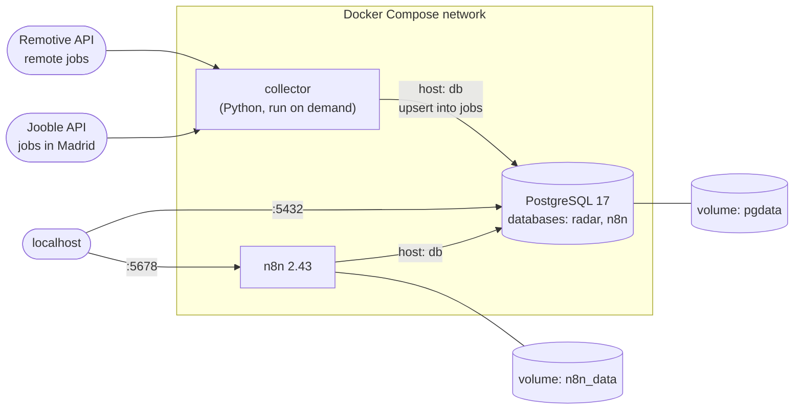

# radar-empleo-ia

AI-powered job radar: collects job offers, stores them in PostgreSQL, scores them against my CV with the Claude API, answers questions about them (RAG) and sends a daily digest to Telegram via n8n.

> Work in progress. This README will grow as each part is built.

## Planned stack

- **Python** — job collection scripts
- **PostgreSQL** — storage and querying
- **Claude API** — scoring with structured output, RAG
- **n8n** — daily Telegram digest
- **Docker Compose** — local environment
- **Terraform + Ansible** — deployment to a VPS

## Architecture (current)



- Services find each other by name on the Compose network (`db`), so no IPs are hard-coded.
- Data lives in named volumes and survives `docker compose down` (but not `down -v`).
- Ports are bound to `127.0.0.1` only, so nothing is exposed to the local network.
- Secrets come from a git-ignored `.env`; `.env.example` lists the variables.

## Getting started

Requirements: Docker with Docker Compose.

```bash
cp .env.example .env          # then fill in the values
docker compose up -d          # start PostgreSQL and n8n
docker compose ps             # both should be "Up"; db should be "healthy"
```

- n8n: http://localhost:5678
- PostgreSQL: `docker compose exec db psql -U <user> -d <db>`
- Collector: `docker compose run --rm collector` (see below)

## Job collector

`collector/` fetches job offers from several sources, turns them into one common `Job` shape (`models.py`) and saves them in PostgreSQL (`db.py`).

| Source | What | Auth | Notes |
| --- | --- | --- | --- |
| [Remotive](https://github.com/remotive-io/remote-jobs-api) | Remote jobs | None | Max ~4 requests a day; jobs must link back to Remotive |
| [Jooble](https://es.jooble.org/api/about) | Jobs in Madrid | Free API key (`JOOBLE_API_KEY`) | `POST` with a JSON body; the key goes in the URL |

How it is built:

- **One adapter per source** (`sources/*.py`): each has `fetch_jobs()` and a `_to_job()` that maps the source's JSON to `Job`. Adding a source means one new module plus one line in `main.py`.
- **Resilient HTTP** (`http_utils.py`): timeouts, retries with exponential backoff on network errors, `429` and `5xx` (honouring `Retry-After`), and fail-fast on other `4xx`.
- **No leaked secrets**: API keys passed as `secret` are replaced with `***` in logs and error messages.
- **One broken source does not stop the others**; the exit code is `1` if any source failed, so a scheduler can notice.
- **Fails before spending API calls** if the database is unreachable.
- **Batch job, not a server**: the Compose service has no `restart` policy and sits behind the `jobs` profile, so `docker compose up` does not start it.

```bash
docker compose build collector
docker compose run --rm collector           # COLLECTOR_SEARCH in .env sets the keyword (default: python)
```

Tests (no network, `requests` and `time.sleep` are mocked):

```bash
cd collector
python3 -m venv .venv && source .venv/bin/activate
pip install -r requirements-dev.txt
python -m pytest -v
```

## Database

The `radar` database holds the jobs. Tables are created by `db/init/*.sql` on the first start of an empty volume; on an existing volume, apply a new script by hand:

```bash
docker compose exec -T db sh -c 'psql -U "$POSTGRES_USER" -d "$POSTGRES_DB"' < db/init/02-create-jobs.sql
```

- **`jobs`**: one row per offer. `UNIQUE (source, external_id)` identifies an offer, so the collector saves with an upsert (`INSERT … ON CONFLICT … DO UPDATE`): running it twice gives the same rows, it only refreshes their data and `last_seen_at`. `first_seen_at` keeps when the offer first appeared.
- **Transactions**: each source is saved in one transaction, so a failure never leaves half a batch.
- **Parameterised queries**: values are sent apart from the SQL (`%(name)s`), which prevents SQL injection.
- **`skills`**: skills from my CV, used as a keyword-matching baseline before LLM scoring.

`db/queries.sql` has example queries: recent jobs in Madrid, jobs with a salary, companies hiring for several roles, and jobs ranked by how many of my skills they mention (a `JOIN` on a regex with word boundaries).

```bash
docker compose exec -T db sh -c 'psql -U "$POSTGRES_USER" -d "$POSTGRES_DB"' < db/queries.sql
```

Keyword matching has clear limits: full-text sources (Remotive) get more matches than snippet sources (Jooble), and it ignores context such as seniority or location. Block 5 adds scoring with Claude.

## Status

- [x] Block 1: repository and Git setup
- [x] Block 2: Docker — collector image, PostgreSQL and n8n with Docker Compose
- [x] Block 3: Python — job collector (Remotive + Jooble) with retries, Compose service and tests
- [x] Block 4: SQL — jobs stored in PostgreSQL without duplicates, queries with filters and a JOIN
- [ ] Block 5: Claude API — score jobs against my CV
