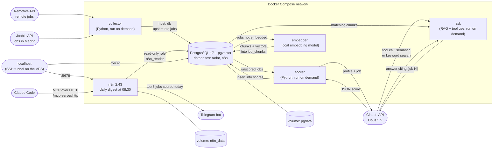

# radar-empleo-ia

AI-powered job radar: collects job offers, stores them in PostgreSQL, scores them against my CV with the Claude API, answers questions about them (RAG) and sends a daily digest to Telegram via n8n.

> Work in progress. This README will grow as each part is built.

## Stack

- **Python** — job collection scripts
- **PostgreSQL** — storage and querying
- **Claude API** — scoring with structured output, RAG
- **n8n** — daily Telegram digest
- **Docker Compose** — runs everything, locally and on the server
- **Terraform + Ansible** — provisioning and configuration of a VPS
- **systemd timers** — daily backups and job pipeline on the server

## Architecture



- Services find each other by name on the Compose network (`db`), so no IPs are hard-coded.
- Data lives in named volumes and survives `docker compose down` (but not `down -v`).
- Ports are bound to `127.0.0.1` only, so nothing is exposed to the network.
- The same Compose file runs on the VPS: see [Deployment](#deployment).
- Secrets come from a git-ignored `.env`; `.env.example` lists the variables.

## Getting started

Requirements: Docker with Docker Compose.

```bash
cp .env.example .env          # then fill in the values
docker compose up -d          # start PostgreSQL and n8n
docker compose ps             # both should be "Up"; db should be "healthy"
```

- n8n: http://localhost:5678
- PostgreSQL: `docker compose exec db psql -U <user> -d <db>`
- Collector: `docker compose run --rm collector` (see below)
- Scorer: `docker compose run --rm scorer` (see below)
- Embedder and questions: `docker compose run --rm embedder`, then `docker compose run --rm ask "…"` (see below)
- Daily Telegram digest: n8n workflows in `n8n/workflows/` (see below)

## Job collector

`collector/` fetches job offers from several sources, turns them into one common `Job` shape (`models.py`) and saves them in PostgreSQL (`db.py`).

| Source | What | Auth | Notes |
| --- | --- | --- | --- |
| [Remotive](https://github.com/remotive-io/remote-jobs-api) | Remote jobs | None | Max ~4 requests a day; jobs must link back to Remotive |
| [Jooble](https://es.jooble.org/api/about) | Jobs in Madrid | Free API key (`JOOBLE_API_KEY`) | `POST` with a JSON body; the key goes in the URL |

How it is built:

- **One adapter per source** (`sources/*.py`): each has `fetch_jobs()` and a `_to_job()` that maps the source's JSON to `Job`. Adding a source means one new module plus one line in `main.py`.
- **Resilient HTTP** (`http_utils.py`): timeouts, retries with exponential backoff on network errors, `429` and `5xx` (honouring `Retry-After`), and fail-fast on other `4xx`.
- **No leaked secrets**: API keys passed as `secret` are replaced with `***` in logs and error messages.
- **One broken source does not stop the others**; the exit code is `1` if any source failed, so a scheduler can notice.
- **Fails before spending API calls** if the database is unreachable.
- **Batch job, not a server**: the Compose service has no `restart` policy and sits behind the `jobs` profile, so `docker compose up` does not start it.

```bash
docker compose build collector
docker compose run --rm collector           # COLLECTOR_SEARCH in .env sets the keyword (default: python)
```

Tests (no network, `requests` and `time.sleep` are mocked):

```bash
cd collector
python3 -m venv .venv && source .venv/bin/activate
pip install -r requirements-dev.txt
python -m pytest -v
```

## Database

The `radar` database holds the jobs. Tables are created by `db/init/*.sql` on the first start of an empty volume; on an existing volume, apply a new script by hand:

```bash
docker compose exec -T db sh -c 'psql -U "$POSTGRES_USER" -d "$POSTGRES_DB"' < db/init/02-create-jobs.sql
```

- **`jobs`**: one row per offer. `UNIQUE (source, external_id)` identifies an offer, so the collector saves with an upsert (`INSERT … ON CONFLICT … DO UPDATE`): running it twice gives the same rows, it only refreshes their data and `last_seen_at`. `first_seen_at` keeps when the offer first appeared.
- **Transactions**: each source is saved in one transaction, so a failure never leaves half a batch.
- **Parameterised queries**: values are sent apart from the SQL (`%(name)s`), which prevents SQL injection.
- **`skills`**: skills from my CV, used as a keyword-matching baseline before LLM scoring.

`db/queries.sql` has example queries: recent jobs in Madrid, jobs with a salary, companies hiring for several roles, and jobs ranked by how many of my skills they mention (a `JOIN` on a regex with word boundaries).

```bash
docker compose exec -T db sh -c 'psql -U "$POSTGRES_USER" -d "$POSTGRES_DB"' < db/queries.sql
```

Keyword matching has clear limits: full-text sources (Remotive) get more matches than snippet sources (Jooble), and it ignores context such as seniority or location. That is what the [Claude scorer](#job-scoring-with-claude) is for.

## Job scoring with Claude

`collector/scorer.py` rates every job against my profile with the Claude API and saves the result in the `scores` table (`db/init/04-create-scores.sql`).

How it works:

1. **Only new work**: it reads the jobs that have no score for the current `PROMPT_VERSION` (`LEFT JOIN scores … WHERE s.job_id IS NULL`). Running it twice costs nothing the second time; `UNIQUE (job_id, prompt_version)` backs this up in the database.
2. **Prompt**: the system prompt holds my profile and a scoring rubric (what 80, 60 and 40 mean, and what weighs most); the job goes in the user message inside `<job_offer>` tags, marked as third-party data so instructions inside a job posting are ignored (prompt injection).
3. **Structured output**: `client.messages.parse()` with a Pydantic model (`JobScore`). The API constrains the answer to that JSON schema and the SDK validates it, so every field maps straight to a column: `score` (0-100), `fit` (`high`/`medium`/`low`), `matched_skills`, `missing_skills`, `salary_ok` (`NULL` when the job does not say) and `reasons`. `CHECK` constraints on the table are a second line of defence.
4. **Errors**: the SDK retries `429` and `5xx` with exponential backoff; a job that still fails is logged and skipped (it is retried on the next run); a rejected API key stops the run. Each score is committed on its own, so a crash never loses scores already paid for.
5. **Cost tracking**: input and output tokens are stored per job. Scoring the first 40 jobs with Claude Opus 5.5 cost $0.80, about 2 cents a job (query 6 in `db/queries.sql`).
6. **Daily limit**: `SCORER_LIMIT` (default 10) caps each run, newest jobs first, so a day with many new offers cannot empty the API balance. The rest wait for later runs.

The profile is personal data: `collector/profile.md` is git-ignored and kept out of the image (it is mounted read-only into the container). Copy `collector/profile.example.md` to start your own.

```bash
docker compose build scorer
docker compose run --rm scorer             # needs ANTHROPIC_API_KEY in .env
# or locally, scoring a single job as a cheap test:
cd collector && set -a && source ../.env && set +a && SCORER_LIMIT=1 .venv/bin/python scorer.py
```

Limits worth knowing:

- Jooble returns a snippet, not the full job description, so those scores rest on less information (the reasons say so when it matters).
- On jobs I had already assessed by hand, the scores agreed with my own judgment (for example, a mid-level "AI Engineer Python" role scored 62, `medium`), but 40 jobs is a small sample.
- No prompt caching: the profile plus rubric is around 1,000 tokens, below the minimum cacheable size for this model.

## Questions about the jobs (RAG)

`collector/ask.py` answers questions in plain language ("¿Qué ofertas en Madrid piden Python e IA generativa?") using only the stored jobs, and cites the jobs it used. It is Retrieval-Augmented Generation where Claude chooses how to search (tool use):

1. **Index** (`collector/embedder.py`, once per new job): each job is cleaned of HTML and split into chunks of 60 words with 15 words of overlap, each starting with the job's title, company and location. Every chunk is turned into a 384-number vector (an *embedding*) and stored in `job_chunks` (`db/init/05-create-job-chunks.sql`) with the [pgvector](https://github.com/pgvector/pgvector) extension.
2. **Retrieve, with tools**: Claude gets two tools and decides which to call, with what words, and how many times:
   - `search_jobs_semantic`: the query is embedded with the same model and PostgreSQL finds the closest chunks by cosine distance (`<=>`). A window function keeps the best two chunks of each job and the six best jobs, so one long offer cannot fill every slot. Good for topics ("cloud infrastructure" also finds AWS).
   - `search_jobs_keyword`: a case-insensitive `ILIKE` over the chunks, with `%` and `_` escaped so the term matches literally. Good for exact names (Docker, Terraform, a company).
3. **Generate**: the search results go back to Claude inside `<job id="N">` tags. The system prompt says to answer only from them, to say so when they do not contain the answer, and to cite every job as `[job N]`. After the answer, the program checks each citation against every job the searches returned, prints the source URLs, and warns about any job cited that no search returned.

The agent loop is written by hand (`ask_claude`): send the question and the tool definitions; while the answer stops with `stop_reason == "tool_use"`, run each requested search and send all results back in one message; stop at `end_turn`. Claude only chooses: the code runs a fixed allow-list of two read-only searches, validates their input, and returns errors as `is_error` tool results so Claude can try another search. The loop is capped at 5 turns, and the last turn sets `tool_choice: none`, so Claude has to answer with what it has; every turn resends the whole conversation, so the cap also caps the cost.

Design choices:

- **Local embeddings** with [fastembed](https://github.com/qdrant/fastembed) and a multilingual model (`paraphrase-multilingual-MiniLM-L12-v2`), because most offers are in Spanish: no API key, no cost per call, and the job texts never leave the machine. The model is downloaded at build time, so the image works offline (it grows to about 1 GB).
- **Why chunks**: the model reads at most 128 tokens (about 80 words). Remotive offers average 650 words of text, so a single vector per job would only see the title and first paragraph.
- **pgvector instead of a separate vector database**: the vectors live next to the jobs they describe, so a plain SQL `JOIN` connects them. With 141 chunks an exact scan takes milliseconds; an HNSW index would be the next step at tens of thousands.
- The `pgvector/pgvector:pg17-trixie` image is used on purpose: it runs on Debian 13 like the previous `postgres:17` image. A Debian 12 build ships an older glibc, whose different text sort order (collation) would put the existing text indexes at risk.

```bash
docker compose build embedder
docker compose run --rm embedder                        # embeds only the jobs not embedded yet
docker compose run --rm ask "¿Alguna oferta pide n8n?"  # needs ANTHROPIC_API_KEY in .env
```

Query 7 in `db/queries.sql` shows the similarity search in plain SQL (jobs closest in meaning to a given one).

Limits worth knowing:

- **Why tool use and not always both searches.** With vector search alone, asking about Docker missed the jobs that mention it: one word barely moves the vector of a 60-word chunk. The keyword tool fixed it (both Docker jobs found and cited). The alternative is *hybrid search*: always run both searches and merge the rankings with a fixed formula (Reciprocal Rank Fusion). That is cheaper and predictable, one Claude call per question; tool use adapts the search to each question (for "generative AI" it searched semantically and for the stem `generativ` at once), at the cost of more calls and less predictable behaviour.
- Claude only sees excerpts, so an answer like "no job asks for X" means "none of the retrieved excerpts do"; the prompt makes it say so.
- The keyword tool matches inside words (`go` also matches "Google"), so the tool description asks for distinctive terms.
- A job whose description changes after it was embedded keeps its old chunks.
- Each question costs about 2-3 cents with Claude Opus 5.5: usually two turns, 2,500-4,000 input tokens.

## Daily digest with n8n

Every day at 08:30 an n8n workflow sends the best jobs scored in the last 24 hours to Telegram:

```
Schedule (08:30) → Postgres: top 5 jobs scored in the last 24 h → IF any? ─yes→ Code: one HTML message → Telegram
                                                                            └no─→ Telegram: "no new jobs"
```

- **Query**: a CTE with `DISTINCT ON` takes each job's latest score, and `count(*) OVER ()` gives the total before `LIMIT 5` ("top 5 of 12"). It filters by scoring date, not first-seen date, so a job delayed by the daily limit still reaches a digest.
- **Always a message**: the Postgres node outputs one empty item when there are no rows, so the IF can send "no new jobs". Silence would look the same as a broken workflow.
- **Escaped HTML**: job titles are third-party text, so `&`, `<` and `>` are escaped before Telegram parses the message.
- **Errors**: a second workflow (Error Trigger → Telegram) is set as the digest's error workflow, so any failure (database down, revoked token) sends an alert with the failing node.
- **Least privilege**: n8n reads the jobs as `n8n_reader` (`db/init/06-create-n8n-reader.sh`), a role that can only `SELECT` from `jobs` and `scores`.
- **Secrets**: the bot token is an n8n credential, encrypted with `N8N_ENCRYPTION_KEY`; workflows only reference it by name. Node access to environment variables stays blocked (n8n's secure default).

Workflows are kept in Git as clean templates (`n8n/workflows/*.json`): no Telegram chat id, no credential ids, no owner data. `n8n/workflows.py` moves them in and out of the running n8n:

```bash
python3 n8n/workflows.py import   # fills in TELEGRAM_CHAT_ID from .env and credential ids by name
python3 n8n/workflows.py export   # pulls them back and strips personal and instance data
```

Setup on a new instance: create the credentials `Telegram Radar` (bot token from @BotFather) and `Postgres Radar (read-only)` (host `db`, user `n8n_reader`), run `import`, then publish the digest **from the n8n editor**. Importing unpublishes workflows, and publishing from the CLI marks them as published without registering their triggers: the schedule silently never ran until it was published from the editor.

### Claude Code over MCP

n8n has a built-in MCP server (`/mcp-server/http`), and Claude Code is connected to it as an MCP client:

```bash
claude mcp add --transport http n8n http://localhost:5678/mcp-server/http --header "Authorization: Bearer <token>"
```

Claude Code can then search the workflows, inspect executions ("did today's digest run?") or run the digest, without opening the editor. The connection is stored in the user's local Claude Code config, not in the repo, and only the daily digest is enabled for MCP access.

Limits worth knowing:

- Bumping `PROMPT_VERSION` rescores old jobs, and they would appear in the next digest as if they were new.
- n8n cannot start the Python containers itself: that would mean giving it the Docker socket, which is control over the whole host.

## Deployment

The app runs on a Hetzner CX23 (2 vCPU, 4 GB of RAM, about €7.25 a month), created and configured from code in `infra/`:

| Step | Tool | What it does |
| --- | --- | --- |
| Provision | Terraform (`infra/terraform/`) | Creates the server, its SSH key and a firewall |
| Bootstrap | Ansible (`bootstrap.yml`) | First run, as root: creates the `deploy` user |
| Configure | Ansible (`server.yml`) | Security settings, swap and Docker |
| Deploy | Ansible (`deploy.yml`) | Code, secrets, image, services and timers |

```bash
export HCLOUD_TOKEN=...                     # better: read -rs HCLOUD_TOKEN && export HCLOUD_TOKEN
cd infra/terraform
cp terraform.tfvars.example terraform.tfvars   # then fill in your IP
terraform init && terraform apply

cd ../ansible
printf '[radar]\n%s\n' "$(terraform -chdir=../terraform output -raw server_ip)" > inventory.ini
ansible-playbook bootstrap.yml
ansible-playbook server.yml                 # a second run should report changed=0
ansible-playbook deploy.yml                 # the server pulls from GitHub: push first
```

**Security.** The firewall only allows SSH from one IP, and Postgres and n8n are also bound to `127.0.0.1`, so a mistake in one layer does not expose them. SSH accepts keys only: root and password logins are disabled, and `server.yml` connects as `deploy`, which proves that user works before root is closed. fail2ban and automatic security updates add further layers. n8n is reached through an SSH tunnel:

```bash
ssh -i ~/.ssh/radar_vps -N -L 5678:localhost:5678 deploy@<server-ip>   # then open http://localhost:5678
```

**Secrets.** `.env` and `collector/profile.md` are not in Git: Ansible copies them from the local machine over SSH with mode `600`. Terraform state, variables and the real inventory are git-ignored too, as they hold the server's address and possibly secrets.

**Daily schedule** (Europe/Madrid):

| Time | Run by | What |
| --- | --- | --- |
| 07:30 | systemd timer | Dumps both databases, keeps a week of copies |
| 08:00 | systemd timer | `collector` → `scorer` → `embedder`, stopping at the first failure |
| 08:30 | n8n | Sends the digest to Telegram |

A failed systemd job sends a Telegram alert directly with `curl` (`TELEGRAM_BOT_TOKEN` in `.env`), so it works even if n8n is down. `Persistent=true` runs a missed timer as soon as the server is back.

**Restoring a backup.** Stop n8n first, restore both databases, then start it again. Use the same `N8N_ENCRYPTION_KEY`, or n8n cannot decrypt its credentials. Then publish the digest from the editor if needed.

```bash
docker compose stop n8n
docker compose exec -T db sh -c 'pg_restore -U "$POSTGRES_USER" -d "$POSTGRES_DB" --clean --if-exists' < radar-YYYY-MM-DD.dump
docker compose exec -T db sh -c 'pg_restore -U "$POSTGRES_USER" -d n8n --clean --if-exists' < n8n-YYYY-MM-DD.dump
docker compose up -d n8n
```

Limits worth knowing:

- **Backups live on the same server.** They protect against mistakes and bad runs, not against losing the server. Copying them off the server is the next step.
- **One server, no redundancy**: if it is down, the digest waits. That is fine for a personal tool.
- **A new home IP locks SSH out** until `terraform.tfvars` is updated and `terraform apply` runs, which works because it goes through Hetzner's API.
- **Terraform state is local**, which suits one person. A team would use a remote, encrypted backend with locking.
- **Hetzner has cost alerts but no hard spending cap**, so an alert is set in its console.

## Status

- [x] Block 1: repository and Git setup
- [x] Block 2: Docker — collector image, PostgreSQL and n8n with Docker Compose
- [x] Block 3: Python — job collector (Remotive + Jooble) with retries, Compose service and tests
- [x] Block 4: SQL — jobs stored in PostgreSQL without duplicates, queries with filters and a JOIN
- [x] Block 5: Claude API — jobs scored against my CV with structured output
- [x] Block 6: RAG — questions about the jobs answered from local embeddings in pgvector, with checked citations
- [x] Block 7: n8n — daily Telegram digest with error alerts, Claude choosing semantic or keyword search with tool use, and Claude Code connected to n8n over MCP
- [ ] Block 8: Cloud — deployed to a VPS with Terraform and Ansible, with daily timers, backups and failure alerts (first unattended run pending)
