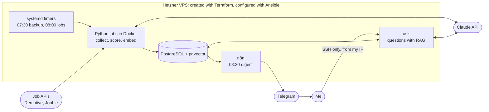
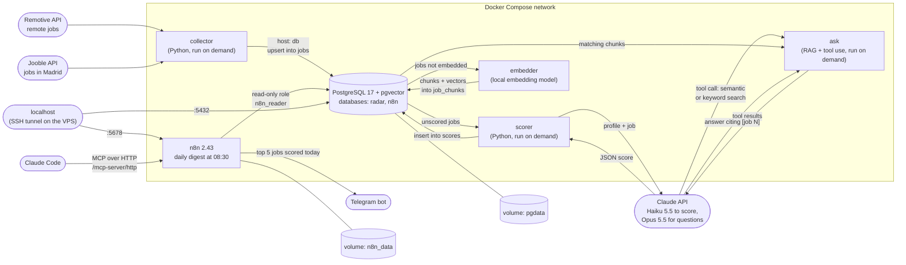

# AI Job Radar

Reading job boards takes hours, and most offers do not fit. This system collects job offers, scores each one against my CV with the Claude API, and sends me the best ones on Telegram, so I only read what is worth applying to. I can also ask questions about the stored offers in plain language.

> **Status:** running on a VPS every morning, with no one at the keyboard.
>
> **Demo:** [watch the video on YouTube](https://youtu.be/1ZDMsGEKpS4) (1:23, in Spanish with English subtitles).

## What it does

1. **Collects** offers from two job APIs with a Python batch job.
2. **Scores** them against my CV with Claude: a 0-100 score, matched and missing skills, and the reasons, as validated structured output.
3. **Sends** the top 5 to Telegram with n8n, or a notice if there is nothing new, so silence always means something is broken.
4. **Answers questions** such as "Which jobs ask for Docker?" with RAG. Claude chooses between semantic and keyword search, and the code checks every citation.

A schedule on the server runs all of this at 08:00 and 08:30, and alerts me on Telegram if a job fails.

## Real numbers

From the first run on the server (1 November 2026):

| | |
| --- | --- |
| Jobs stored | 66, from 2 sources |
| Jobs scored | 50, capped at 10 per run to control cost |
| Cost per scored job | $0.0008 with Claude Haiku 5.5, against $0.026 with Claude Opus 5.5 on the same 21 jobs |
| Server | €7.25 a month |

## What it demonstrates

| Area | In this project |
| --- | --- |
| **Python** | API clients with retries and exponential backoff, secrets hidden from logs, 15 tests with `pytest` |
| **SQL** | PostgreSQL 17, idempotent upserts, parameterised queries, `JOIN`s and window functions |
| **LLMs** | Claude API, structured output, prompt injection defences, cost tracking per job |
| **RAG and agents** | Local embeddings in pgvector, a hand-written tool use loop with a turn limit, checked citations |
| **Automation** | n8n workflows with error handling, kept in Git as clean templates, and Claude Code connected over MCP |
| **Infrastructure** | Docker Compose, Terraform, Ansible and systemd timers on a VPS |
| **Security and operations** | Layered firewall and SSH hardening, least-privilege database role, tested backups, failure alerts |

## Architecture



<details>
<summary>Detailed view of the containers</summary>



</details>

- Services find each other by name on the Compose network (`db`), so no IPs are hard-coded.
- Data lives in named volumes and survives `docker compose down` (but not `down -v`).
- Ports are bound to `127.0.0.1` only, so nothing is exposed to the network.
- The same Compose file runs on the VPS: see [Deployment](docs/deployment.md).
- Secrets come from a git-ignored `.env`; `.env.example` lists the variables.

## Getting started

Requirements: Docker with Docker Compose.

```bash
cp .env.example .env          # then fill in the values
docker compose up -d          # start PostgreSQL and n8n
docker compose ps             # both should be "Up"; db should be "healthy"
```

- n8n: http://localhost:5678
- PostgreSQL: `docker compose exec db psql -U <user> -d <db>`
- Collect, score and embed: `docker compose run --rm collector`, then `scorer`, then `embedder`
- Ask a question: `docker compose run --rm ask "¿Alguna oferta pide n8n?"`
- Daily digest: see [the n8n guide](docs/n8n.md) to set up its credentials and workflows

## Limits worth knowing

- **Scores are an aid, not a verdict.** They agreed with my own judgment on the jobs I checked, but the sample is small, and Jooble only provides a snippet of each offer.
- **One server, no redundancy.** If it is down, the digest waits, which is fine for a personal tool.
- **Backups live on the same server.** They cover mistakes and bad runs, not losing the server. Copying them elsewhere is the next step.
- **Scoring is capped at 10 jobs per run** to control cost, so a busy day takes longer to work through.

## Documentation

| Guide | Covers |
| --- | --- |
| [Job collector](docs/collector.md) | Sources, retries, error handling and tests |
| [Database](docs/database.md) | Tables, upserts, transactions and example queries |
| [Job scoring](docs/scoring.md) | Prompt, structured output, errors and cost |
| [Questions (RAG)](docs/rag.md) | Embeddings, tool use loop and design choices |
| [Daily digest](docs/n8n.md) | n8n workflows, error alerts and MCP |
| [Deployment](docs/deployment.md) | Terraform, Ansible, security, schedule and backups |

## Status

- [x] Block 1: repository and Git setup
- [x] Block 2: Docker — collector image, PostgreSQL and n8n with Docker Compose
- [x] Block 3: Python — job collector (Remotive + Jooble) with retries, Compose service and tests
- [x] Block 4: SQL — jobs stored in PostgreSQL without duplicates, queries with filters and a JOIN
- [x] Block 5: Claude API — jobs scored against my CV with structured output
- [x] Block 6: RAG — questions about the jobs answered from local embeddings in pgvector, with checked citations
- [x] Block 7: n8n — daily Telegram digest with error alerts, Claude choosing semantic or keyword search with tool use, and Claude Code connected to n8n over MCP
- [x] Block 8: Cloud — deployed to a VPS with Terraform and Ansible, with daily timers, backups and failure alerts
- [x] Block 9: Showcase — README, diagram and a [demo video](https://youtu.be/1ZDMsGEKpS4)
