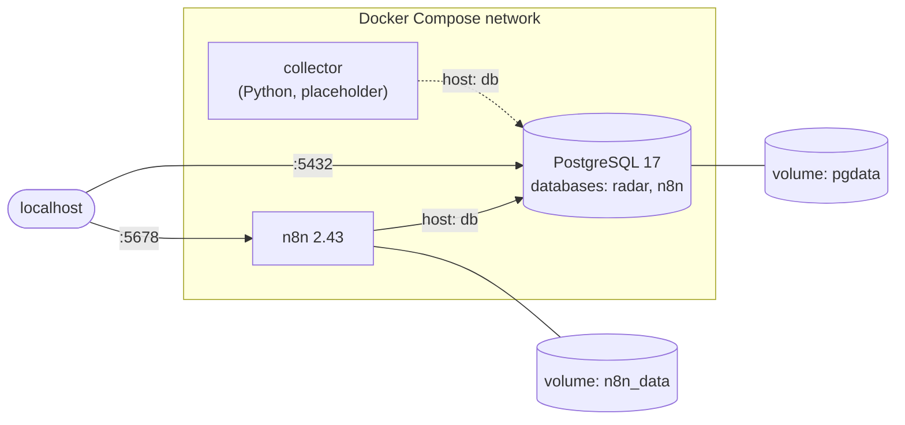

# radar-empleo-ia

AI-powered job radar: collects job offers, stores them in PostgreSQL, scores them against my CV with the Claude API, answers questions about them (RAG) and sends a daily digest to Telegram via n8n.

> Work in progress. This README will grow as each part is built.

## Planned stack

- **Python** — job collection scripts
- **PostgreSQL** — storage and querying
- **Claude API** — scoring with structured output, RAG
- **n8n** — daily Telegram digest
- **Docker Compose** — local environment
- **Terraform + Ansible** — deployment to a VPS

## Architecture (current)



- Services find each other by name on the Compose network (`db`), so no IPs are hard-coded.
- Data lives in named volumes and survives `docker compose down` (but not `down -v`).
- Ports are bound to `127.0.0.1` only, so nothing is exposed to the local network.
- Secrets come from a git-ignored `.env`; `.env.example` lists the variables.

## Getting started

Requirements: Docker with Docker Compose.

```bash
cp .env.example .env          # then fill in the values
docker compose up -d          # start PostgreSQL and n8n
docker compose ps             # both should be "Up"; db should be "healthy"
```

- n8n: http://localhost:5678
- PostgreSQL: `docker compose exec db psql -U <user> -d <db>`
- Collector (placeholder): `docker build -t radar-collector ./collector && docker run --rm radar-collector`

## Status

- [x] Block 1: repository and Git setup
- [x] Block 2: Docker — collector image, PostgreSQL and n8n with Docker Compose
